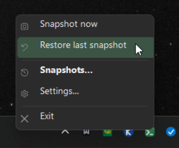
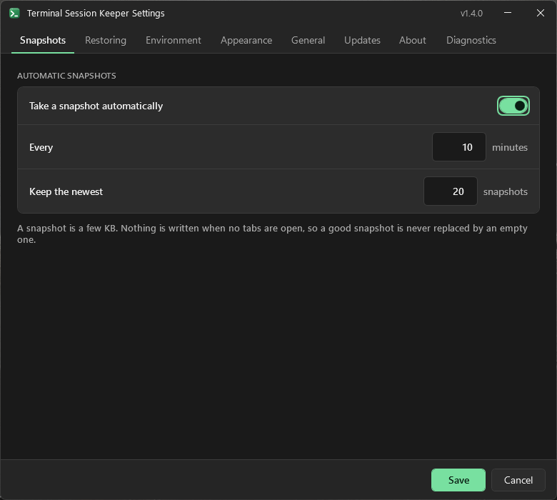

# Terminal Session Keeper

Saves your open Windows Terminal tabs — including the live agent conversations
inside them — and puts them back after a restart.

Windows Update does not care that you had twelve tabs open, each in a different
project with a different agent session. This does.

It is a tray app. There is no main window or scheduled task. PowerShell tabs that
change directory after launch need an optional [prompt hook](docs/GUIDE.md#powershell-directory-capture)
to save their current location accurately.

## Updates And What’s New

Clicking **Update** checks the latest stable release again before downloading, so a prompt left open skips any superseded versions. The installer URL and SHA-256 both come from that fresh check. If the check fails, the app stops and reports the error instead of installing the old offer.

After installation or an upgrade, **What’s New** shows the running version’s main changes from the bundled changelog, with **Got it** and **View full change history**. It remembers the shown version on this PC, so normal restarts stay quiet.

## Features

- **Snapshots your tabs** — directory, title, colour and the agent session running in each one, automatically every 10 minutes.
- **Restores after a reboot** — each tab comes back in its own directory with its resume command waiting at the prompt.
- **Knows four agents** — Claude Code, Codex, Antigravity and Junie, on the Windows side of a tab or inside WSL.
- **Nothing starts on its own** — press Enter in the tabs you actually want, or switch on automatic resume if you disagree.
- **Controls restored WSL tabs** — add `NAME=value` variables only to tabs a restore creates, and choose whether it types a final `cd` back into each tab's saved folder.
- **Keeps titles and colours**, including hand-renamed tabs, matched by content and, when reliable matches confirm it, tab order. A restored colour is applied the way the colour picker applies one, so the terminal's own **Reset** still clears it.
- **Browse every snapshot** — see what is in it and preview exactly what a restore would launch.

## Requirements

Windows Terminal 1.18 or newer. WSL tabs additionally need `python3` inside the
distro — that is all, and only to read the WSL side. Windows tabs work without WSL
at all.

## Install

Download **[TerminalSessionKeeper-Setup.exe](https://github.com/alexlvcom/TerminalSessionKeeper/releases/latest/download/TerminalSessionKeeper-Setup.exe)**
and run it. Setup installs to `%LOCALAPPDATA%\Programs\Terminal Session Keeper`
without administrator privileges and preserves your settings and snapshots during upgrades.

The app checks for updates at startup and daily by default. Choose the interval on
the Settings Updates tab and click **Save**, or check manually there; manual
checking is also available in About. **Update** downloads and verifies the
installer. The download timeout starts on that click; a timeout shows an error
and lets you retry.

Open **Settings…** from its tray menu, tick **Start with Windows**, and you are
done.

The exe is unsigned, so Windows may show a SmartScreen warning on first run. See
[Install and first run](docs/GUIDE.md#install-and-first-run) for what that means
and how to verify the download.

## Documentation

- **[User guide](docs/GUIDE.md)** — the tray menu, every setting, how sessions and titles are found, and what to check when something looks wrong.
- **[Development](docs/DEVELOPMENT.md)** — building from source and the versioning conventions.
